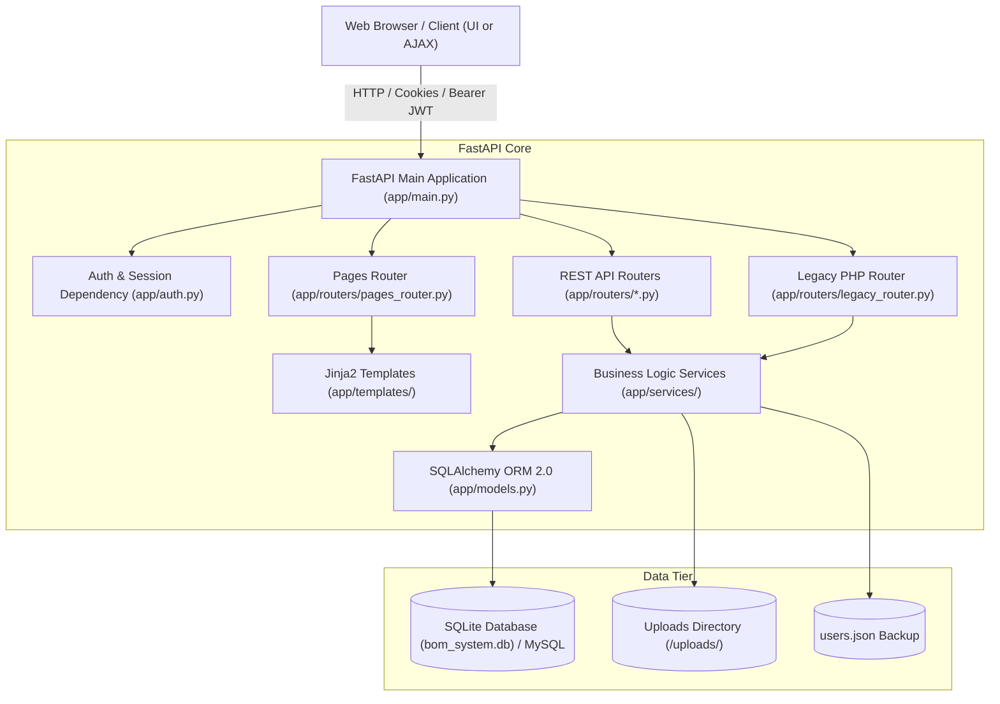
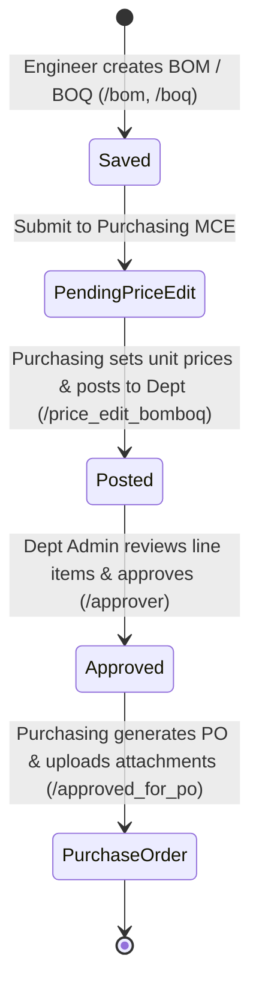

# 🏗️ BOM / BOQ Studio Pro (FastAPI Framework Edition)

[](https://fastapi.tiangolo.com)
[](https://www.python.org)
[](https://www.sqlalchemy.org)
[](https://jwt.io)
[]()

**BOM / BOQ Studio Pro** is an enterprise-grade Bill of Materials (BOM) and Bill of Quantities (BOQ) engineering management web application. Originally developed in procedural PHP, this application has been fully modernized and re-engineered using **Python 3.12** and the high-performance **FastAPI** framework.

All historical data (37 user accounts, 14 engineering documents, 4 file attachments, and 450+ activity audit logs) from `bom_db_dump.sql`, `users.json`, and `/uploads` have been seamlessly migrated and preserved.

---

## 📑 Table of Contents
- [✨ Key Improvements & Highlights](#-key-improvements--highlights)
- [🏛️ System Architecture](#️-system-architecture)
- [📁 Project Directory Structure](#-project-directory-structure)
- [🚀 Quickstart & Installation](#-quickstart--installation)
- [👥 Role Hierarchy](#-role-hierarchy)
- [🔄 Engineering Document Lifecycle](#-engineering-document-lifecycle)
- [📖 In-App Help / User Manual](#-in-app-help--user-manual)
- [📡 API & Legacy Compatibility](#-api--legacy-compatibility)
- [🎨 Themes & Modernized UI](#-themes--modernized-ui)
- [🧪 Testing & Verification](#-testing--verification)

---

## ✨ Key Improvements & Highlights

1. **Modern FastAPI Backend**:
   - Asynchronous request handling with automatic OpenAPI / Swagger interactive documentation (`/docs`).
   - Clean separation of concerns: Routers, Services, Schemas, ORM Models, and Configuration.
   - Dual Database Support: Out-of-the-box zero-setup **SQLite** (`bom_system.db`) with full compatibility for **MySQL** / **PostgreSQL** via `DATABASE_URL`.

2. **Enterprise Security & Authentication**:
   - Hybrid authentication supporting both **JSON Web Tokens (JWT)** and **HTTP-only session cookies** (`bom_session_token`).
   - Transparent verification for legacy PHP bcrypt (`$2y$`) hashes and developer test passwords.
   - Strict role hierarchy enforcement across all modules: `admin`, `department_admin`, `user`, and `guest`.

3. **Modern, Responsive UI & Theme Engine**:
   - Clean, modern layout with responsive typography, KPI metrics, status capsules, and quick-action cards.
   - Non-blocking toast notifications and confirmation dialogs replacing intrusive browser alerts.
   - Fully preserved **9 visual themes** (Default, Dark, Corporate, Sci-Fi, Cyberpunk, Neon, Glassmorphism, Anime, Light) with persistent preference caching.

4. **100% Backward Compatibility**:
   - Legacy PHP endpoints (`api/document_api.php`, `api/user_api.php`, `api/estimate_api.php`, `api/upload_api.php`) are fully maintained and respond with identical JSON schemas.
   - Bookmark-friendly PHP page aliases (`/index.php`, `/bom.php`, `/login.php`, etc.) route automatically without breaking existing user links.

5. **Integrated File Upload Hub**:
   - Secure PO attachment management with **magic-byte validation** (preventing MIME spoofing) for PDF, JPG, and PNG files up to 10MB.

---

## 🏛️ System Architecture



---

## 📁 Project Directory Structure

```text
/mnt/d/bom_finalv1.1.2/
├── app/
│   ├── __init__.py
│   ├── config.py                 # Application settings, secrets, paths, and limits
│   ├── database.py               # SQLAlchemy database engine, sessionmaker, and init_db()
│   ├── models.py                 # ORM models: User, Document, DocumentAttachment, ActivityLog, CostEstimate
│   ├── schemas.py                # Pydantic request/response validation schemas
│   ├── auth.py                   # Password hashing, JWT creation/decoding, role dependencies
│   ├── main.py                   # FastAPI main app, static mounts, CORS, lifespan, exception handlers
│   ├── routers/
│   │   ├── auth_router.py        # /api/auth/login, register, logout, me
│   │   ├── users_router.py       # /api/users/ CRUD and synchronization
│   │   ├── documents_router.py   # /api/documents/ BOM/BOQ lifecycle endpoints
│   │   ├── estimates_router.py   # /api/estimates/ Project Cost Estimates CRUD
│   │   ├── uploads_router.py     # /api/uploads/ PO attachment file uploads & downloads
│   │   ├── logs_router.py        # /api/logs/ Audit logging, pagination, and exports
│   │   ├── pages_router.py       # HTML template views & legacy .php redirects
│   │   └── legacy_router.py      # Backward compatibility for api/*.php AJAX calls
│   ├── services/
│   │   ├── activity_service.py   # Central audit trail logger
│   │   ├── document_service.py   # Document queries, status changes, and MCE pricing
│   │   ├── estimate_service.py   # Project cost estimate calculations and formulas
│   │   ├── user_service.py       # User management and users.json synchronization
│   │   └── seed_service.py       # Automated parser for bom_db_dump.sql & users.json
│   ├── static/
│   │   ├── css/
│   │   │   ├── main.css          # Design system, KPI cards, tables, modals, badges, toasts
│   │   │   └── themes.css        # 9 customizable color schemes
│   │   └── js/
│   │       ├── app.js            # Toast notification library, confirmation modals, API fetch wrapper
│   │       ├── themes.js         # Theme selector modal and preference storage
│   │       └── document_sync.js  # FastAPI document sync with localStorage fallback
│   └── templates/
│       ├── base.html             # Master layout with navigation bar, user capsule, theme selector
│       ├── index.html            # Dashboard with real-time KPI metrics & recent activity
│       ├── login.html            # Split-screen sign-in and role-based registration
│       ├── bom.html              # Interactive Bill of Materials editor with live cost calculation
│       ├── boq.html              # Interactive Bill of Quantities editor with labor breakdown
│       ├── save_bomboq.html      # Saved documents manager with search and status tabs
│       ├── price_edit_bomboq.html# Purchasing MCE unit price editor, document rename and department posting
│       ├── help.html             # In-app Help / User Manual (/help), available to all signed-in users
│       ├── settings.html         # Administrator Settings (/settings): Public Help and Guest Sign-up switches
│       ├── approver.html         # Department Admin approval review interface
│       ├── approved_for_po.html  # Purchasing PO hub with drag-and-drop file upload
│       ├── estimate.html         # Project cost estimate calculator (Materials, Labor, Allowances)
│       ├── user_logs.html        # Comprehensive audit logs with live filter and CSV/JSON export
│       └── users_admin.html      # User management control panel for administrators
├── tests/
│   └── test_full_suite.py        # End-to-end automated test suite covering all modules
├── uploads/                      # Storage directory for PO document attachments
├── data/                         # Persistent Docker mount directory (database & uploads)
├── bom_system.db                 # Seeded SQLite database (37 users, 15 documents, 480+ logs)
├── Dockerfile                    # Container image definition with integrated Tailscale
├── docker-compose.yml            # Docker Compose stack with auto-restart & volume persistence
├── entrypoint.sh                 # Container lifecycle script for Tailscale & FastAPI
├── .env.example                  # Template configuration for Tailscale keys & secrets
├── .dockerignore                 # Excludes caches and virtual environments
├── requirements.txt              # Python package dependencies
├── run.py                        # Uvicorn startup script
├── DEPLOYMENT.md                 # Complete Docker container & Tailscale deployment guide
└── README.md                     # Comprehensive project documentation
```

---

## 🐳 Docker & Tailscale Funnel Deployment

Deploy with integrated **Tailscale Funnel**, making the application accessible worldwide over HTTPS at **`https://bom.ratfish-regulus.ts.net`**, with automatic host reboot recovery and persistent data mounts:

### First Administrator on an empty database
If you deploy without the initial `bom_system.db`, nobody can sign in, because creating an Admin from the login page needs an existing Admin's credentials. Create the first Administrator from the server:
```bash
docker compose exec bom python create-admin.py            # prompts for username and password
docker compose exec bom python create-admin.py --username Admin --reset   # reset a forgotten Admin password
```
Without Docker, run `python create-admin.py` from the project folder (with the same `DATABASE_URL` / `DATA_DIR` as the app). The password is never accepted on the command line; for unattended setups, set `BOM_ADMIN_PASSWORD` in the environment instead.

### 1. Quick Launch
```bash
# 1. Copy environment template
cp .env.example .env

# 2. (Optional) Add your Tailscale Auth Key to .env
nano .env

# 3. Build & start container
docker compose up -d --build
```

### 2. Access Endpoints
- **🌍 Public HTTPS (Tailscale Funnel):** `https://bom.ratfish-regulus.ts.net`
- **🔒 Private Tailscale MagicDNS:** `http://bom:8000`
- **🏠 Local Machine Access:** `http://localhost:8000`
- **📖 Swagger Documentation:** `https://bom.ratfish-regulus.ts.net/docs`
- **💾 Persistent Data:** Stored in `./data` (zero data loss across reboots)
- **🔄 Auto-Restart:** Configured with `restart: unless-stopped` for instant boot recovery

👉 **See [DEPLOYMENT.md](file:///mnt/d/bom_finalv1.1.2/DEPLOYMENT.md) for complete step-by-step instructions and Tailnet ACL setup.**

---

## 💻 Local Development Quickstart (Without Docker)

### 1. Prerequisites
- Python 3.10+ (Python 3.12 recommended)
- `pip` package manager

### 2. Setup Virtual Environment
```bash
# Navigate to the project root
cd /mnt/d/bom_finalv1.1.2

# Create virtual environment if not already present
python3 -m venv venv

# Activate virtual environment
source venv/bin/activate
```

### 3. Install Dependencies
```bash
pip install -r requirements.txt
```

### 4. Run the Application
```bash
python run.py
```
*The application starts at `http://localhost:8000`.*
*The SQLite database is pre-seeded and automatically initialized on startup.*

### 5. Access Interactive Documentation
- **Swagger UI**: [http://localhost:8000/docs](http://localhost:8000/docs)
- **ReDoc**: [http://localhost:8000/redoc](http://localhost:8000/redoc)

---

## 👥 Role Hierarchy

| Role | Typical department | Permissions & Purpose |
|:---|:---|:---|
| **`admin`** (System Administrator) | Admin | Full system access: every page, user administration, API keys, audit logs and approvals for all departments. The only role that can edit, send back or delete **approved** documents, and remove posted documents. |
| **`department_admin`** (Department Admin) | Any | Everything a `user` can do, plus reviewing and approving documents posted to **their own** department (`/approver`). |
| **`user`** (Department Member) | Engineering, Operations, Electrical, Technical, … | Create BOMs, BOQs and cost estimates; edit, delete and send their department's documents to MCE. |
| **`user`** in **Purchasing** | Purchasing | MCE unit price editing, renaming and posting (`/price_edit_bomboq`), unposting for correction, and the PO hub with attachments (`/approved_for_po`). Saved documents are **view-only**, and the BOM / BOQ / Estimate builders are not available. |
| **`guest`** | — | Read-only: browse and preview documents; cannot save, edit, post or delete. |

* Accounts are created by an Administrator at **Administration → Users** (`/users_admin`), or through **Create Account** on the sign-in page.
* **Create Account always needs Authorizing Credentials** from an existing, **active** account:

  | New account's role | Who can authorize it |
  |:---|:---|
  | `guest`, `user` | Any `user`, `department_admin` or `admin` |
  | `department_admin`, `admin` | An `admin` only |

  Unknown role names are rejected (`400`).
* **Guest Sign-up switch:** Administrators can allow or block Guest sign-ups with the **Guest Sign-up** switch on **Administration → Settings** (`/settings`), or with `GET` / `PUT /api/admin/settings/guest-signup` and `{"enabled": true|false}`. It is on by default.
  * When it is off, the Guest role disappears from the form and `/api/auth/register` rejects Guest sign-ups with `403`.
  * Existing Guest accounts are not affected.
  * Every change is written to the audit log (`guest_signup_enabled` / `guest_signup_disabled`).
* A full, role-aware explanation of every page is available in the app at **Support → Help** (`/help`).

### 🔒 Password Management

| Feature | Who | Where |
|:---|:---|:---|
| **First sign-in password change** | Every user except Administrators | Forced full-screen at `/change_password` until done. Pages redirect there, and the API returns `403 password_change_required`. |
| **Change my password** | Every signed-in user, including Administrators | Account menu (top right) → **Change password** |
| **Reset a user's password** | Administrators | `/users_admin` → **Password** → *Reset password*. Generates a temporary password, shown once. The user must change it at next sign-in. |
| **Change a user's password** | Administrators | `/users_admin` → **Password** → *Change password*. Sets a specific password, with an option to require a change at next sign-in. |

* **Password rules:** at least 8 characters, at least one letter and one number, and not the same as the username.
* **Sign-out:** any password change or reset signs the account out of its other sessions.
* **Audit log:** every change or reset is recorded (`password_change`, `admin_reset_password`, `admin_change_password`).
* **Own account:** Administrators can't reset their own password from `/users_admin`. They use **Change password**, which asks for the current password.
* **Existing databases:** they are upgraded automatically on startup, with new `users.must_change_password` and `users.password_changed_at` columns.

---

## 🔄 Engineering Document Lifecycle

The system enforces a compliant, multi-department engineering document workflow:



1. **Creation**: Engineer fills project info, items, quantities, and units. System calculates subtotals and grand totals in real time.
2. **Purchasing Review**: Purchasing department opens the document in MCE Pricing (`/price_edit_bomboq`), enters verified vendor unit prices, and posts it to the target department.
3. **Department Approval**: Department Admin reviews line items in Approvals (`/approver`) and approves the final amounts.
4. **Purchase Order Execution**: Document appears in Approved for PO (`/approved_for_po`), where purchasing attaches vendor quotations, drawings, and purchase requisitions.

### MCE Pricing page (`/price_edit_bomboq`)
- Full-width layout with summary cards (pending / posted / saved counts) and a search box that filters every table.
- **Pending Price Edit** → *View*, *Edit Unit Cost* (highlighted cost fields, live totals), *Post* (choose the target department).
- **Posted for PO** → *View*, *Print*, *Unpost* (back to Pending as `unposted` for correction) and *Remove*.
- **Remove permanently deletes the document** and is shown to **Administrators only**. If the server refuses a delete, the page shows the error and keeps the row instead of reporting success.
- **Rename a document**: click the pencil icon next to its name, type the new name, press <kbd>Enter</kbd> (<kbd>Esc</kbd> cancels).
  - Names are the document key across the app, so a name already used by another document is rejected.
  - Allowed for Administrators, Purchasing, the owner and the owner's department. Purchasing may rename only documents in the MCE workflow (`pending_price_edit`, `posted`, `unposted`). Approved documents can be renamed by Administrators only.
  - Every rename is written to the audit log (`rename`). Attachments stay linked, because they reference the document ID.

### Saved Documents page (`/save_bomboq`)
- Wider page (up to 1760px) with clickable summary cards that double as filters, tabs with count badges, search across name / reference no. / project / department / creator, a department filter and **Clear filters**.
- Table with BOM/BOQ markers, status badges with a lock icon for approved documents, the creator, and the last-modified time shown in the viewer's local time zone.
- Document names are HTML-escaped, and names containing apostrophes no longer break the row actions.

---

## 📖 In-App Help / User Manual

Every signed-in user has a **Help** item in the sidebar (**Support → Help**, `/help`). It opens a full user manual:

1. Introduction, workflow and document statuses
2. Getting started: signing in, creating an account, the roles & permissions matrix and navigation, with a personalized **"Your access"** summary for the signed-in user
3. Every page and feature, button by button
4. Step-by-step guides (expandable). The admin-only guides appear only for Administrators.
5. Tips & best practices
6. Troubleshooting

The manual has a sticky table of contents that follows your scroll position, and a search box that filters and highlights topics. It supports the dark theme and prints cleanly.

### Public Quick Help (`/quick-help`)
- The sign-in page shows a **Quick Help** link to a public, read-only copy of the manual, so people can read it before they have an account.
- **Administrators control it** with the **Public Help** switch on **Administration → Settings** (`/settings`), or through `GET` / `PUT /api/admin/settings/public-help` with `{"enabled": true|false}`. It is on by default. Every change is written to the audit log (`public_help_enabled` / `public_help_disabled`).
- When it is **hidden**, the link disappears from `/login` and `/quick-help` returns the normal 404, the same as any URL that doesn't exist. Signed-in users still have `/help`.
- **Security:**
  - The public page is rendered with no user, so it contains no API key, no personal "Your access" summary and none of the admin-only guides. It makes no API calls.
  - It is served with `X-Robots-Tag: noindex, nofollow`, `Cache-Control: no-store` and `Referrer-Policy: no-referrer`.
  - Signed-in visitors are redirected to the full `/help`.
  - The setting is stored in the new `app_settings` table, which is created automatically on startup.

---

## 📡 API & Legacy Compatibility

### 🔑 Department API Keys
Every `/api/*` request must send a department API key in the `X-API-Key` header.

| Situation | Response |
|---|---|
| No key, unknown key, or a deactivated key | `401` (`error`: `api_key_missing` / `api_key_invalid` / `api_key_inactive`) |
| A valid key from a different department than the signed-in user | `403` (`api_key_department_mismatch`) |

- **One key per department**, stored in the `department_api_keys` table (SHA-256 hash for lookup, plus an encrypted copy). Users without a department share the **Unassigned** key.
- **Browser users need to do nothing.** Pages render the signed-in user's department key into `<meta name="api-key">`, and `app.js` adds the header to every same-origin `/api` call.
- **Keys are issued automatically** when a department first appears (at startup, or when a user is created or moved into it). A key an Administrator revoked stays revoked.
- **Manage keys** at **Administration → API Keys** (`/api_keys`, Administrators only): generate or regenerate, activate or deactivate, revoke, reveal, and see when each key was last used. Every action is written to the audit log.
- **Endpoints that don't need a key:** `/api/health`, `/api/auth/login`, `/api/auth/register` and `/api/auth/logout`. The Administrator-only `/api/admin/api-keys/*` endpoints are also exempt, so an Administrator can always restore access.
- **Command line** (uses `generate_api_key()` from `api-key-gen.py`, the same generator the server uses):
  ```bash
  python api-key-gen.py --list                     # departments + masked keys
  python api-key-gen.py --department "Purchasing"  # generate / replace a department's key
  python api-key-gen.py --all-missing              # issue keys where none exist
  ```
- **Encryption secret:** stored keys are encrypted with `API_KEY_ENCRYPTION_KEY`, which defaults to `SECRET_KEY`. If you change that secret, regenerate the keys.

### RESTful Endpoints
- **Authentication**: `POST /api/auth/login`, `POST /api/auth/register`, `POST /api/auth/logout`, `GET /api/auth/me`
- **Documents**: `GET /api/documents/`, `POST /api/documents/`, `GET /api/documents/{id}`, `POST /api/documents/{id}/price-edit`, `POST /api/documents/{id}/approve`, `GET /api/documents/approved-for-po`
- **Cost Estimates**: `GET /api/estimates/`, `POST /api/estimates/`, `GET /api/estimates/{id}`, `PUT /api/estimates/{id}`, `DELETE /api/estimates/{id}`
- **Attachments**: `POST /api/uploads/`, `GET /api/uploads/{id}/download`, `DELETE /api/uploads/{id}`
- **Audit Logs**: `GET /api/logs/`, `GET /api/logs/stats`, `GET /api/logs/export`
- **Users**: `GET /api/users/`, `POST /api/users/`, `PUT /api/users/{id}`, `POST /api/users/sync`

### Legacy PHP Endpoints (100% Maintained)
- `POST /api/document_api.php` (supports `save`, `load`, `list`, `update_status`, `save_price_edit`, `rename`, `delete`, `list_for_approval`, `approve`, `list_approved`, `sync`, `get_attachments`, `delete_attachment`)
  - `rename` takes `documentName` (current) and `newName` and returns `{success, message, name}`. A duplicate name, a missing document or a lack of permission returns `success: false`. Locked or restricted documents return `403`.
- `POST /api/user_api.php` (supports `status`, `list`, `sync_to_json`)
- `POST /api/estimate_api.php` (supports `list`, `save`, `update`, `delete`)
- `POST /api/upload_api.php` (multipart file upload with original response payload)

---

## 🎨 Themes & Modernized UI

The app uses a sidebar layout: grouped navigation on the left (**Overview**, **Documents**, **Workflow**, **Administration**, **Support → Help**). It collapses to icons on desktop and slides in as a drawer on phones and tablets. There is also a top bar with the page title and an account menu.

The working pages use wide layouts so large documents fit on screen: `/price_edit_bomboq`, `/approver`, `/approved_for_po` and `/estimate` go up to 1680px, `/save_bomboq` up to 1760px, and document preview windows up to 1400–1600px. The **Logout** button on `/approver` signs out through `/api/auth/logout` and returns to `/login`, like the rest of the app. Click the **palette icon** in the top bar, or **Themes** in the account menu, to switch themes. Themes are rendered using CSS variables and persist across browser reloads:

| Theme | Key Visual Style |
|:---|:---|
| **Default** | Clean corporate indigo and slate design |
| **Dark Theme** | Deep slate #0f172a with high-contrast emerald & sky accents |
| **Corporate** | Professional navy and steel blue enterprise tone |
| **Glassmorphism** | Frosted glass backdrop with blurred card panels |
| **Cyberpunk** | High-energy electric yellow and neon cyan palette |
| **Sci-Fi** | Deep space black with electric cobalt and purple glows |
| **Neon** | Ultra-vibrant magenta and purple night mode |
| **Light Theme** | Crisp minimalist white and cool gray |
| **Anime** | Playful cherry blossom rose and pastel lilac |

---

## 🧪 Testing & Verification

An end-to-end automated test suite verifies all layers of the application:
```bash
./venv/bin/python tests/test_full_suite.py
```

> ⚠️ The suite writes to the database it runs against, which is `bom_system.db` by default. Point it at a throwaway database to keep real data untouched:
> ```bash
> DATABASE_URL="sqlite:////tmp/bom_test.db" PYTHONIOENCODING=utf-8 ./venv/bin/python tests/test_full_suite.py
> ```
> On Windows, `PYTHONIOENCODING=utf-8` avoids a `UnicodeEncodeError` from the emoji in the test output.

### Verified Test Suites:
1. **Database Schema & Data Seeding**: 37 users, 15 documents, 4 attachments, 480+ logs verified.
2. **Route Protection**: Unauthenticated requests redirect to `/login`; authenticated requests serve 200 OK.
3. **Authentication**: Reject bad passwords, issue JWT tokens, set HTTP-only cookies, `/api/auth/me`.
4. **HTML Pages**: All views rendered with Jinja2, including the Help page (`/help`, open to every signed-in user). Role protection redirects non-authorized users.
5. **Document REST APIs**: Create, retrieve, and list documents.
6. **Workflow Cycle**: Purchasing price edit -> Department Admin approval -> Approved for PO hub.
7. **Cost Estimates API**: Full calculation and CRUD operations.
8. **Legacy Compatibility**: Exact JSON response match for legacy `.php` API calls.
9. **Audit Logs**: Filtering and pagination.
10. **OpenAPI**: Swagger UI and schema generation with zero warnings.

---

## 👨‍💻 Developer & Maintenance Information
- **Lead Developer**: Engr. Alex
- **Framework**: FastAPI / Python 3.12
- **License**: Proprietary / Internal Enterprise Use
