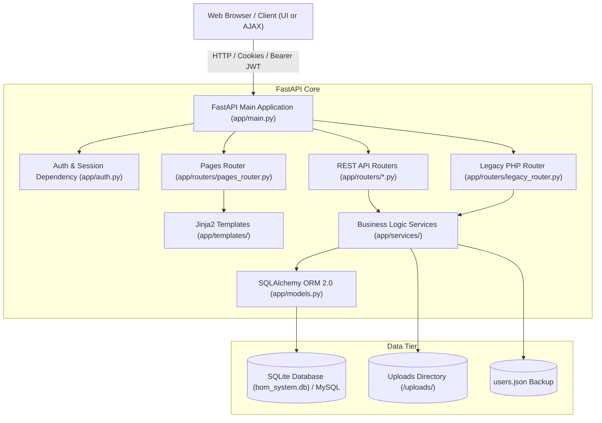
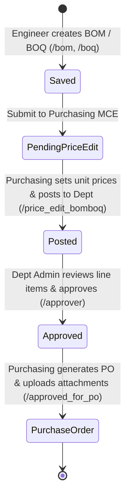

# 🏗️ BOM / BOQ Studio Pro (FastAPI Framework Edition)

[](https://fastapi.tiangolo.com)
[](https://www.python.org)
[](https://www.sqlalchemy.org)
[](https://jwt.io)
[]()

**BOM / BOQ Studio Pro** is an enterprise-grade Bill of Materials (BOM) and Bill of Quantities (BOQ) engineering management web application. Originally developed in procedural PHP, this application has been fully modernized and re-engineered using **Python 3.12** and the high-performance **FastAPI** framework.

All historical data (37 user accounts, 14 engineering documents, 4 file attachments, and 450+ activity audit logs) from `bom_db_dump.sql`, `users.json`, and `/uploads` have been seamlessly migrated and preserved.

---

## 📑 Table of Contents
- [✨ Key Improvements & Highlights](#-key-improvements--highlights)
- [🏛️ System Architecture](#️-system-architecture)
- [📁 Project Directory Structure](#-project-directory-structure)
- [🚀 Quickstart & Installation](#-quickstart--installation)
- [👥 Demo Accounts & Role Hierarchy](#-demo-accounts--role-hierarchy)
- [🔄 Engineering Document Lifecycle](#-engineering-document-lifecycle)
- [📡 API & Legacy Compatibility](#-api--legacy-compatibility)
- [🎨 Themes & Modernized UI](#-themes--modernized-ui)
- [🧪 Testing & Verification](#-testing--verification)

---

## ✨ Key Improvements & Highlights

1. **Modern FastAPI Backend**:
   - Asynchronous request handling with automatic OpenAPI / Swagger interactive documentation (`/docs`).
   - Clean separation of concerns: Routers, Services, Schemas, ORM Models, and Configuration.
   - Dual Database Support: Out-of-the-box zero-setup **SQLite** (`bom_system.db`) with full compatibility for **MySQL** / **PostgreSQL** via `DATABASE_URL`.

2. **Enterprise Security & Authentication**:
   - Hybrid authentication supporting both **JSON Web Tokens (JWT)** and **HTTP-only session cookies** (`bom_session_token`).
   - Transparent verification for legacy PHP bcrypt (`$2y$`) hashes and developer test passwords.
   - Strict role hierarchy enforcement across all modules: `admin`, `department_admin`, `user`, and `guest`.

3. **Modern, Responsive UI & Theme Engine**:
   - Clean, modern layout with responsive typography, KPI metrics, status capsules, and quick-action cards.
   - Non-blocking toast notifications and confirmation dialogs replacing intrusive browser alerts.
   - Fully preserved **9 visual themes** (Default, Dark, Corporate, Sci-Fi, Cyberpunk, Neon, Glassmorphism, Anime, Light) with persistent preference caching.

4. **100% Backward Compatibility**:
   - Legacy PHP endpoints (`api/document_api.php`, `api/user_api.php`, `api/estimate_api.php`, `api/upload_api.php`) are fully maintained and respond with identical JSON schemas.
   - Bookmark-friendly PHP page aliases (`/index.php`, `/bom.php`, `/login.php`, etc.) route automatically without breaking existing user links.

5. **Integrated File Upload Hub**:
   - Secure PO attachment management with **magic-byte validation** (preventing MIME spoofing) for PDF, JPG, and PNG files up to 10MB.

---

## 🏛️ System Architecture



---

## 📁 Project Directory Structure

```text
/mnt/d/bom_finalv1.1.2/
├── app/
│   ├── __init__.py
│   ├── config.py                 # Application settings, secrets, paths, and limits
│   ├── database.py               # SQLAlchemy database engine, sessionmaker, and init_db()
│   ├── models.py                 # ORM models: User, Document, DocumentAttachment, ActivityLog, CostEstimate
│   ├── schemas.py                # Pydantic request/response validation schemas
│   ├── auth.py                   # Password hashing, JWT creation/decoding, role dependencies
│   ├── main.py                   # FastAPI main app, static mounts, CORS, lifespan, exception handlers
│   ├── routers/
│   │   ├── auth_router.py        # /api/auth/login, register, logout, me
│   │   ├── users_router.py       # /api/users/ CRUD and synchronization
│   │   ├── documents_router.py   # /api/documents/ BOM/BOQ lifecycle endpoints
│   │   ├── estimates_router.py   # /api/estimates/ Project Cost Estimates CRUD
│   │   ├── uploads_router.py     # /api/uploads/ PO attachment file uploads & downloads
│   │   ├── logs_router.py        # /api/logs/ Audit logging, pagination, and exports
│   │   ├── pages_router.py       # HTML template views & legacy .php redirects
│   │   └── legacy_router.py      # Backward compatibility for api/*.php AJAX calls
│   ├── services/
│   │   ├── activity_service.py   # Central audit trail logger
│   │   ├── document_service.py   # Document queries, status changes, and MCE pricing
│   │   ├── estimate_service.py   # Project cost estimate calculations and formulas
│   │   ├── user_service.py       # User management and users.json synchronization
│   │   └── seed_service.py       # Automated parser for bom_db_dump.sql & users.json
│   ├── static/
│   │   ├── css/
│   │   │   ├── main.css          # Design system, KPI cards, tables, modals, badges, toasts
│   │   │   └── themes.css        # 9 customizable color schemes
│   │   └── js/
│   │       ├── app.js            # Toast notification library, confirmation modals, API fetch wrapper
│   │       ├── themes.js         # Theme selector modal and preference storage
│   │       └── document_sync.js  # FastAPI document sync with localStorage fallback
│   └── templates/
│       ├── base.html             # Master layout with navigation bar, user capsule, theme selector
│       ├── index.html            # Dashboard with real-time KPI metrics & recent activity
│       ├── login.html            # Split-screen auth with role-based registration & quick logins
│       ├── bom.html              # Interactive Bill of Materials editor with live cost calculation
│       ├── boq.html              # Interactive Bill of Quantities editor with labor breakdown
│       ├── save_bomboq.html      # Saved documents manager with search and status tabs
│       ├── price_edit_bomboq.html# Purchasing MCE unit price editor and department posting
│       ├── approver.html         # Department Admin approval review interface
│       ├── approved_for_po.html  # Purchasing PO hub with drag-and-drop file upload
│       ├── estimate.html         # Project cost estimate calculator (Materials, Labor, Allowances)
│       ├── user_logs.html        # Comprehensive audit logs with live filter and CSV/JSON export
│       └── users_admin.html      # User management control panel for administrators
├── tests/
│   └── test_full_suite.py        # End-to-end automated test suite covering all modules
├── uploads/                      # Storage directory for PO document attachments
├── data/                         # Persistent Docker mount directory (database & uploads)
├── bom_system.db                 # Seeded SQLite database (37 users, 15 documents, 480+ logs)
├── Dockerfile                    # Container image definition with integrated Tailscale
├── docker-compose.yml            # Docker Compose stack with auto-restart & volume persistence
├── entrypoint.sh                 # Container lifecycle script for Tailscale & FastAPI
├── .env.example                  # Template configuration for Tailscale keys & secrets
├── .dockerignore                 # Excludes caches and virtual environments
├── requirements.txt              # Python package dependencies
├── run.py                        # Uvicorn startup script
├── DEPLOYMENT.md                 # Complete Docker container & Tailscale deployment guide
└── README.md                     # Comprehensive project documentation
```

---

## 🐳 Docker & Tailscale Funnel Deployment

Deploy with integrated **Tailscale Funnel**, making the application accessible worldwide over HTTPS at **`https://bom.ratfish-regulus.ts.net`**, with automatic host reboot recovery and persistent data mounts:

### 1. Quick Launch
```bash
# 1. Copy environment template
cp .env.example .env

# 2. (Optional) Add your Tailscale Auth Key to .env
nano .env

# 3. Build & start container
docker compose up -d --build
```

### 2. Access Endpoints
- **🌍 Public HTTPS (Tailscale Funnel):** `https://bom.ratfish-regulus.ts.net`
- **🔒 Private Tailscale MagicDNS:** `http://bom:8000`
- **🏠 Local Machine Access:** `http://localhost:8000`
- **📖 Swagger Documentation:** `https://bom.ratfish-regulus.ts.net/docs`
- **💾 Persistent Data:** Stored in `./data` (zero data loss across reboots)
- **🔄 Auto-Restart:** Configured with `restart: unless-stopped` for instant boot recovery

👉 **See [DEPLOYMENT.md](file:///mnt/d/bom_finalv1.1.2/DEPLOYMENT.md) for complete step-by-step instructions and Tailnet ACL setup.**

---

## 💻 Local Development Quickstart (Without Docker)

### 1. Prerequisites
- Python 3.10+ (Python 3.12 recommended)
- `pip` package manager

### 2. Setup Virtual Environment
```bash
# Navigate to the project root
cd /mnt/d/bom_finalv1.1.2

# Create virtual environment if not already present
python3 -m venv venv

# Activate virtual environment
source venv/bin/activate
```

### 3. Install Dependencies
```bash
pip install -r requirements.txt
```

### 4. Run the Application
```bash
python run.py
```
*The application starts at `http://localhost:8000`.*
*The SQLite database is pre-seeded and automatically initialized on startup.*

### 5. Access Interactive Documentation
- **Swagger UI**: [http://localhost:8000/docs](http://localhost:8000/docs)
- **ReDoc**: [http://localhost:8000/redoc](http://localhost:8000/redoc)

---

## 👥 Demo Accounts & Role Hierarchy

| Username | Role | Department | Password | Permissions & Purpose |
|:---|:---|:---|:---|:---|
| **`Admin`** | `admin` | Admin | `admin123` / `T0ms1234` | Full system access, user administration, global approvals |
| **`Engr. Alex`** | `user` | Engineering | `123456` | BOM/BOQ creation, cost estimate builder, departmental files |
| **`Mark`** | `user` | Purchasing | `123456` | MCE unit price editing, PO attachment uploads, PO hub |
| **`Edward`** | `department_admin` | Ops | `123456` | Review and approve documents posted to Ops department |
| **`Ryan`** | `department_admin` | DAC | `123456` | Review and approve documents posted to DAC department |
| **`Testguest`** | `guest` | — | `guest123` | Read-only exploration access |

*Quick login buttons are available directly on the login screen (`/login`) for instant one-click testing.*

---

## 🔄 Engineering Document Lifecycle

The system enforces a compliant, multi-department engineering document workflow:



1. **Creation**: Engineer fills project info, items, quantities, and units. System calculates subtotals and grand totals in real time.
2. **Purchasing Review**: Purchasing department opens the document in MCE Pricing (`/price_edit_bomboq`), enters verified vendor unit prices, and posts it to the target department.
3. **Department Approval**: Department Admin reviews line items in Approvals (`/approver`) and approves the final amounts.
4. **Purchase Order Execution**: Document appears in Approved for PO (`/approved_for_po`), where purchasing attaches vendor quotations, drawings, and purchase requisitions.

---

## 📡 API & Legacy Compatibility

### RESTful Endpoints
- **Authentication**: `POST /api/auth/login`, `POST /api/auth/register`, `POST /api/auth/logout`, `GET /api/auth/me`
- **Documents**: `GET /api/documents/`, `POST /api/documents/`, `GET /api/documents/{id}`, `POST /api/documents/{id}/price-edit`, `POST /api/documents/{id}/approve`, `GET /api/documents/approved-for-po`
- **Cost Estimates**: `GET /api/estimates/`, `POST /api/estimates/`, `GET /api/estimates/{id}`, `PUT /api/estimates/{id}`, `DELETE /api/estimates/{id}`
- **Attachments**: `POST /api/uploads/`, `GET /api/uploads/{id}/download`, `DELETE /api/uploads/{id}`
- **Audit Logs**: `GET /api/logs/`, `GET /api/logs/stats`, `GET /api/logs/export`
- **Users**: `GET /api/users/`, `POST /api/users/`, `PUT /api/users/{id}`, `POST /api/users/sync`

### Legacy PHP Endpoints (100% Maintained)
- `POST /api/document_api.php` (supports `save`, `load`, `list`, `update_status`, `save_price_edit`, `delete`, `list_for_approval`, `approve`, `list_approved`, `sync`)
- `POST /api/user_api.php` (supports `status`, `list`, `sync_to_json`)
- `POST /api/estimate_api.php` (supports `list`, `save`, `update`, `delete`)
- `POST /api/upload_api.php` (multipart file upload with original response payload)

---

## 🎨 Themes & Modernized UI

Click the **🎨 Themes** button in the top navigation bar at any time to switch themes. Themes are rendered using CSS variables and persist across browser reloads:

| Theme | Key Visual Style |
|:---|:---|
| **Default** | Clean corporate indigo and slate design |
| **Dark Theme** | Deep slate #0f172a with high-contrast emerald & sky accents |
| **Corporate** | Professional navy and steel blue enterprise tone |
| **Glassmorphism** | Frosted glass backdrop with blurred card panels |
| **Cyberpunk** | High-energy electric yellow and neon cyan palette |
| **Sci-Fi** | Deep space black with electric cobalt and purple glows |
| **Neon** | Ultra-vibrant magenta and purple night mode |
| **Light Theme** | Crisp minimalist white and cool gray |
| **Anime** | Playful cherry blossom rose and pastel lilac |

---

## 🧪 Testing & Verification

An end-to-end automated test suite verifies all layers of the application:
```bash
./venv/bin/python tests/test_full_suite.py
```

### Verified Test Suites:
1. **Database Schema & Data Seeding**: 37 users, 15 documents, 4 attachments, 480+ logs verified.
2. **Route Protection**: Unauthenticated requests redirect to `/login`; authenticated requests serve 200 OK.
3. **Authentication**: Reject bad passwords, issue JWT tokens, set HTTP-only cookies, `/api/auth/me`.
4. **HTML Pages**: All 10 views rendered with Jinja2; role protection redirects non-authorized users.
5. **Document REST APIs**: Create, retrieve, and list documents.
6. **Workflow Cycle**: Purchasing price edit -> Department Admin approval -> Approved for PO hub.
7. **Cost Estimates API**: Full calculation and CRUD operations.
8. **Legacy Compatibility**: Exact JSON response match for legacy `.php` API calls.
9. **Audit Logs**: Filtering and pagination.
10. **OpenAPI**: Swagger UI and schema generation with zero warnings.

---

## 👨‍💻 Developer & Maintenance Information
- **Lead Developer**: Engr. Alex
- **Framework**: FastAPI / Python 3.12
- **License**: Proprietary / Internal Enterprise Use
